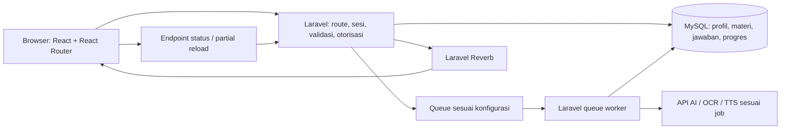

# ARTASWAHA

**Bahasa Bali jadi seru dipelajari.**

ARTASWAHA adalah platform pembelajaran bahasa, sastra, dan aksara Bali berbasis web. Pengguna dapat membaca materi, berlatih melalui kuis, mengikuti permainan bersama, serta memperoleh saran belajar berdasarkan minat dan aktivitas yang tercatat. Antarmuka mendukung desktop dan tampilan aplikasi pada mobile untuk pengguna akun maupun anonim.

## 1. Project Name & Description

| Identitas | Keterangan |
| --- | --- |
| Nama produk | ARTASWAHA |
| Bidang | Pendidikan bahasa dan budaya Bali |
| Bentuk aplikasi | Web dengan React dan React Router, didukung Laravel |
| Materi | Paribasa Bali dan Aksara Bali |
| Kontak pengelola | [kerthajayasoftware@gmail.com](mailto:kerthajayasoftware@gmail.com) |

Repository ini berisi aplikasi, migrasi database, seeder materi dan latihan, pengujian, serta panduan deployment. Konfigurasi rahasia dan layanan eksternal tidak disertakan.

## 2. Problem & Target User

Materi bahasa dan aksara Bali membutuhkan penyajian yang mudah dibaca, contoh yang dekat dengan keseharian, dan latihan yang memberi umpan balik. Pengguna juga membutuhkan cara melihat perkembangan dan menentukan materi berikutnya tanpa harus memahami seluruh katalog terlebih dahulu.

ARTASWAHA ditujukan untuk:

- **Murid/pelajar:** mempelajari materi bertahap dan mengerjakan latihan.
- **Guru:** menggunakan materi dan membuat kuis untuk pembelajaran bersama.
- **Pendatang:** mengenal bahasa serta aksara Bali dari dasar.
- **Masyarakat umum:** belajar mandiri sesuai minat dan waktu yang tersedia.

Pilihan peran pada interview digunakan untuk personalisasi, bukan pemberian hak akses guru atau murid. Hak administratif tetap diperiksa secara terpisah di server.

## 3. Key Features

- **Interview awal:** memilih beberapa minat belajar, peran, dan cara melanjutkan; jawaban tersimpan untuk rekomendasi.
- **Profil anonim dan akun:** belajar dengan nama panggilan/avatar tanpa email, atau masuk menggunakan email dan Google. Profil anonim disimpan di server dan dikenali melalui cookie browser.
- **Materi bertahap:** jalur Cecimpedan, Peparikan, Sesonggan, serta aksara Wreastra/gantungan, pengangge suara, tengenan, ardasuara, dan angka Bali. Modul berikutnya terkunci sampai prasyarat selesai.
- **Latihan modul:** pilihan tunggal, pilihan banyak, dan esai/jawaban singkat; keyboard aksara Bali tersedia pada soal yang sesuai. Jawaban benar/salah mendapat umpan balik, animasi, dan efek suara yang dapat dibisukan.
- **Pengulangan dan progres:** ringkasan hasil, riwayat percobaan baru saat mengulang, progres materi/modul, aktivitas belajar, dan navigasi ke modul selanjutnya.
- **Kuis bersama:** bergabung menggunakan kode room enam digit; akun anonim dapat bergabung dan menjawab. Membuat kuis dan menjadi host memerlukan akun terdaftar. Timer dan penampilan jawaban mengikuti pengaturan pembuat kuis.
- **Pembuatan kuis:** editor bertahap dan draf soal berbantuan AI dari dokumen/gambar melalui OCR, untuk diperiksa sebelum disimpan.
- **Analisis belajar:** saran berdasarkan minat, penyelesaian modul, hari aktif, jawaban kuis, dan hasil pengulangan yang tercatat.
- **Panel admin:** pengelolaan jalur/modul, tinjauan konten/audio, statistik Chart.js, indikator pengunjung aktif, serta pemantauan dan pengujian pekerjaan AI.
- **Privasi dan kendali akun:** kebijakan penggunaan data dan penghapusan akun, termasuk anonim, setelah konfirmasi mengetik `Hapus Akun Saya`.

## 4. Tech Stack

| Area | Teknologi |
| --- | --- |
| Backend | PHP 8.4, Laravel 13, Eloquent |
| Frontend | React 19, React Router 8, Vite 8 |
| Tampilan dan animasi | Tailwind CSS 4, Motion for React, CSS, SVG |
| Grafik | Chart.js |
| Database | MySQL; SQLite in-memory untuk pengujian PHP |
| Cache dan antrean | Redis; koneksi antrean mengikuti `QUEUE_CONNECTION` |
| Realtime | Laravel Reverb, Laravel Echo, Pusher JS client |
| Autentikasi | Sesi Laravel, Laravel Socialite untuk Google OAuth |
| AI dan dokumen | API kompatibel OpenAI melalui konfigurasi AI; layanan OCR terpisah |
| Audio pembelajaran | Integrasi TTS yang dikonfigurasi di server; efek jawaban dari aset audio lokal |
| Pengujian | PHPUnit 12, Vitest, React Testing Library |
| Hosting | VPS dengan aaPanel, Nginx/PHP-FPM, MySQL, Redis, Supervisor |

Versi persis dependency mengikuti `composer.lock` dan `package-lock.json`. UI aktif menggunakan React/React Router; Blade hanya dipakai untuk dokumen root, loader awal, dan sitemap. Detail implementasi terdapat pada [panduan React](docs/REACT.md).

## 5. AI Implementation

Aplikasi menggunakan layanan model melalui endpoint kompatibel OpenAI `/chat/completions`. Endpoint dan model dapat diganti melalui `.env`, tanpa menyimpan API key di frontend.

Contoh konfigurasi pada `.env.example`:

```dotenv
AI_API_URL=http://127.0.0.1:20128/v1
AI_API_KEY=
AI_MODEL=ag/gemini-3.8-flash-medium
```

Nama model tersebut adalah identifier konfigurasi gateway; ketersediaannya mengikuti layanan yang dijalankan pengelola. Isi API key di `.env` jika endpoint membutuhkannya.

| Implementasi | Masukan | Keluaran dan pengamanan |
| --- | --- | --- |
| Analisis belajar | Peran, minat, statistik aktivitas, hasil jawaban dan pengulangan | Ringkasan yang menyapa pengguna dengan “kamu” dan rekomendasi materi yang tersedia. JSON divalidasi dan ID rekomendasi dibatasi pada materi yang diizinkan. |
| Draf kuis | Teks dari dokumen/gambar yang diekstraksi layanan OCR | Soal, opsi, jawaban acuan, dan pembahasan untuk ditinjau pembuat kuis. Dokumen diperlakukan sebagai data, bukan instruksi. |
| Interpretasi admin | Snapshot statistik aplikasi | Ringkasan observasi dan saran berdasarkan angka yang tercatat. |

Analisis dijalankan melalui job antrean. Scheduler memeriksa kebutuhan pembaruan setiap jam; hasil yang masih berlaku umumnya diperbarui sekitar setiap enam jam. Pengujian manual admin dapat meminta analisis tanpa menunggu interval tersebut. Hasil terakhir tetap dapat ditampilkan selama pembaruan diproses.

Analisis belajar tidak mengirim nama, email, avatar, atau ID akun/browser ke model. Namun, informasi pribadi yang dimasukkan ke dokumen unggahan dapat ikut diproses oleh OCR/AI. TTS merupakan integrasi terpisah untuk menghasilkan audio dan memerlukan konfigurasi serta model/provider tersendiri.

Kode utama: [LearnerInterviewAnalyzer](app/Services/LearnerInterviewAnalyzer.php), [QuizDraftGenerator](app/Services/QuizDraftGenerator.php), [AdminAiService](app/Services/AdminAiService.php), dan [ContentAudioService](app/Services/ContentAudioService.php).

## 6. Run Instructions

### Prasyarat

- PHP 8.4 dan ekstensi yang diminta Composer.
- Composer 2, Node.js 22.22 atau lebih baru yang kompatibel dengan Vite 8, dan npm.
- MySQL dan Redis untuk konfigurasi development bawaan.
- Layanan AI/OCR, Google OAuth, SMTP, dan TTS hanya untuk fitur yang menggunakannya.

### Instalasi lokal

Jalankan dari direktori repository setelah di-clone:

```bash
composer install --no-interaction
npm ci --ignore-scripts
cp .env.example .env
php artisan key:generate --no-interaction
```

Sesuaikan `.env`:

- `APP_URL` sesuai alamat development.
- `DB_*`, `REDIS_*`, `CACHE_STORE`, dan `QUEUE_CONNECTION` sesuai layanan lokal.
- `ADMIN_NAME`, `ADMIN_EMAIL`, dan `ADMIN_PASSWORD` untuk akun admin seeder. Gunakan password minimal 12 karakter; seeder production memvalidasinya dan tidak menyediakan password bawaan.
- `GOOGLE_CLIENT_ID`, `GOOGLE_CLIENT_SECRET`, dan `GOOGLE_REDIRECT_URI` untuk Google OAuth.
- `AI_*`, `OCR_*`, dan `TTS_*` sesuai kebutuhan fitur.
- Konfigurasi `MAIL_*` untuk email nyata; bawaan `MAIL_MAILER=log` hanya mencatat email ke log.

Buat database MySQL yang ditentukan di `.env`, lalu jalankan:

```bash
php artisan migrate --seed --no-interaction
php artisan storage:link --no-interaction
npm run build
```

`DatabaseSeeder` menjalankan seeder jalur belajar, admin, materi Aksara Bali/Paribasa, serta record audio/laporan sesuai implementasinya. Seeder record audio tidak berarti file audio TTS langsung tersedia. Jangan menggunakan `migrate:fresh` pada database yang berisi data pengguna.

### Menjalankan aplikasi

Jalankan proses berikut pada terminal terpisah sesuai kebutuhan:

```bash
# HTTP development
php artisan serve --no-interaction

# Antrean: mengikuti koneksi di .env, tidak memaksa Redis
php artisan queue:work --sleep=3 --tries=3 --timeout=240 --max-time=3600 --no-interaction

# WebSocket kuis bersama
php artisan reverb:start --no-interaction

# Pemeriksaan terjadwal analisis dan room
php artisan schedule:work --no-interaction

# SSR untuk hasil build
npm run ssr
```

Untuk hot reload frontend, jalankan `npm run dev`. Jika tidak menjalankan SSR selama development, gunakan `REACT_SSR_ENABLED=false` pada `.env` lokal. Pada production, gunakan proses yang dikelola Supervisor dan scheduler sesuai [panduan deployment](docs/DEPLOYMENT.md), bukan server development.

Layanan AI, OCR, dan TTS disiapkan terpisah. Repository ini tidak otomatis menyediakan layanan tersebut ketika Laravel dijalankan. Pengaturan timeout/retry audio yang lebih panjang dijelaskan pada [panduan production](docs/PRODUCTION.md).

### Pengujian

```bash
php artisan test --compact
npm run test:react
npm run build
```

## 7. Architecture / Data Flow



1. Browser baru melewati loader dan interview; pengguna yang identitasnya sudah dikenali dapat melanjutkan sesuai status akunnya.
2. React Router mengelola navigasi tanpa reload penuh dan mengambil data JSON dari route Laravel. Controller dan presenter mengirim props yang diperlukan, sementara layout tetap dipertahankan.
3. Server memeriksa izin/prasyarat, menerima jawaban, menghitung hasil, dan menyimpan progres. Pengulangan modul menyimpan percobaan baru.
4. Pekerjaan AI/audio/draf dijalankan di antrean. Klien memeriksa status dan menampilkan hasil yang sudah tersimpan.
5. Reverb menyampaikan perubahan room; server tetap menjadi sumber kebenaran untuk timer, hasil, dan akses peserta.

| Direktori | Tanggung jawab |
| --- | --- |
| `app/Http/Controllers`, `app/Http/Requests`, `app/Http/Middleware` | HTTP, validasi, identitas, dan akses |
| `app/Services`, `app/Jobs` | Aturan bisnis, integrasi, dan pekerjaan antrean |
| `app/Models`, `database/migrations`, `database/seeders` | Data, skema, serta materi awal |
| `resources/js/react` | Halaman, layout, komponen, dan hooks React |
| `resources/css`, `public` | Tema dan aset |
| `routes`, `tests`, `docs` | Route/scheduler, pengujian, dan dokumentasi |

## 8. Deployment URL

- **Platform:** [https://artaswaha.kerthajaya.com](https://artaswaha.kerthajaya.com)
- **Kebijakan privasi:** [https://artaswaha.kerthajaya.com/kebijakan-privasi](https://artaswaha.kerthajaya.com/kebijakan-privasi)

Akses awal mengikuti alur interview/login. Panel admin memerlukan akun dengan hak admin; kredensial tidak dipublikasikan di README. Ketersediaan layanan eksternal mengikuti konfigurasi production.

## 9. Team Members

| Nama | Peran |
| --- | --- |
| Anak Agung Gede Satria Putra Wibawa | Ketua tim |
| Anak Agung Gde Krisna Satya Wibawa | Anggota tim |
| I Komang Wisnu Juniarta | Anggota tim |

## 10. Known Limitations

- **Esai dinilai dengan pencocokan jawaban acuan**, bukan evaluasi AI terhadap uraian bebas. Variasi jawaban yang tidak terdaftar dapat dianggap salah.
- Analisis menggunakan aktivitas yang tercatat, bukan pengukuran seluruh waktu membaca, durasi belajar, atau diagnosis kemampuan. Hasil AI dapat keliru dan rekomendasi bukan penilaian akademis.
- Pembaruan AI bergantung pada worker, scheduler, koneksi, dan layanan model. Interval pemeriksaan tidak menjamin job selesai tepat waktu.
- Profil anonim bergantung pada cookie browser. Menghapus cookie dapat memutus akses; hal tersebut tidak otomatis menghapus data di server.
- Google OAuth, email keluar, draf OCR/AI, dan TTS memerlukan layanan/kredensial yang valid. Audio yang belum tersedia atau belum ditinjau tidak otomatis dapat diputar.
- Pengunjung “online” merupakan perkiraan dari heartbeat dalam dua menit terakhir, bukan jumlah koneksi langsung atau bukti pengguna sedang membaca.
- Materi dan soal latihan disusun untuk aplikasi; kelengkapan serta ketepatan contoh bahasa tetap membutuhkan peninjauan pengajar/ahli Bahasa Bali.
- Pengujian otomatis tidak menggantikan uji HP fisik, aksesibilitas menyeluruh, dan pengukuran beban/latensi MySQL serta jaringan production.

## 11. Third-party Resources

### Library dan layanan

- Framework dan UI: Laravel, React Router, React, Vite, Tailwind CSS, Motion, Chart.js.
- Realtime dan autentikasi: Laravel Reverb, Laravel Echo, Pusher JS client, Laravel Socialite, Google OAuth.
- Pengujian: PHPUnit, Vitest, React Testing Library.
- Infrastruktur/integrasi: MySQL, Redis, endpoint AI kompatibel OpenAI, layanan OCR, dan opsi TTS seperti Chatterbox sesuai konfigurasi.
- Tipografi: Plus Jakarta Sans, Outfit, dan font Aksara Bali Vimala. Aset maskot/avatar serta efek jawaban berada di `public/`; asal dan izin penggunaan tiap aset perlu disertakan oleh pemilik aset sebelum distribusi ulang.

Dependency dicatat pada [composer.json](composer.json), [package.json](package.json), dan lockfile masing-masing. Masing-masing library, model, dokumen, dan aset tetap tunduk pada lisensi pemiliknya; README ini tidak memberikan lisensi ulang atas sumber tersebut.

### Rujukan materi

Rujukan berikut tercantum pada seeder. Materi serta soal disusun ulang untuk latihan ARTASWAHA, bukan salinan bank soal atau soal ujian resmi.

- [Dinas Kebudayaan Buleleng — Pasang Aksara Bali](https://disbudpar.bulelengkab.go.id/informasi/detail/artikel/24-pasang-aksara-bali).
- [Unicode — struktur aksara Bali](https://unicode.org/versions/Unicode16.0.0/core-spec/chapter-17/) dan [daftar karakter Bali](https://www.unicode.org/charts/PDF/U1B00.pdf).
- [Undiksha — lampiran rujukan bentuk latihan aksara](https://repo.undiksha.ac.id/5831/9/1315051061-LAMPIRAN.pdf).
- [Paribasa Basa Bali](https://id.scribd.com/doc/294471338/Paribasa-Basa-Bali), [Bahasa Bali](https://id.scribd.com/document/399384717/Bahasa-Bali), dan [Cecimpedan](https://id.scribd.com/document/645712970/CECIMPEDAN).
- [Universitas PGRI Mahadewa Indonesia — Buku Kasusastran Bali](https://repo.mahadewa.ac.id/id/eprint/2447/1/BUKU%20KASUSASTRAN%20BALI.pdf).

Lihat [AksaraBaliLessonSeeder](database/seeders/AksaraBaliLessonSeeder.php) dan [ParibasaLessonSeeder](database/seeders/ParibasaLessonSeeder.php) untuk hubungan sumber, materi, dan soal.

Panduan lanjutan: [arsitektur React](docs/REACT.md), [deployment](docs/DEPLOYMENT.md), [production](docs/PRODUCTION.md), [coding](docs/CODING.md), [keamanan](docs/SECURITY.md), dan [aturan commit](docs/COMMIT.md).
